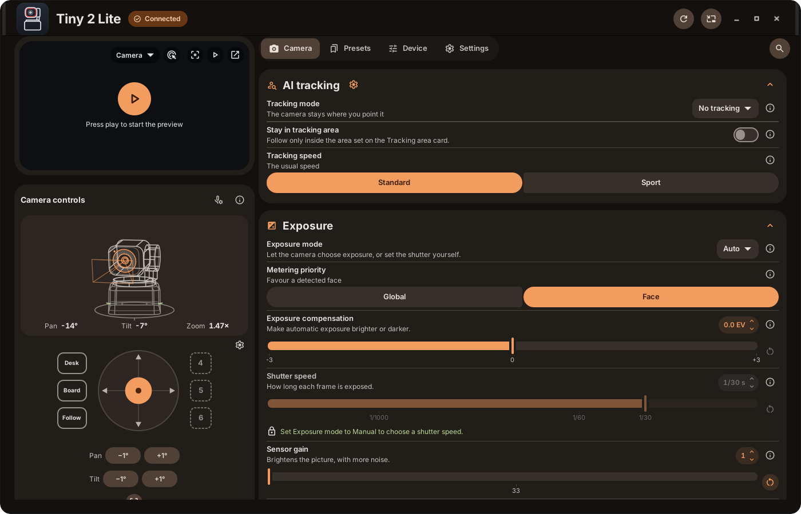
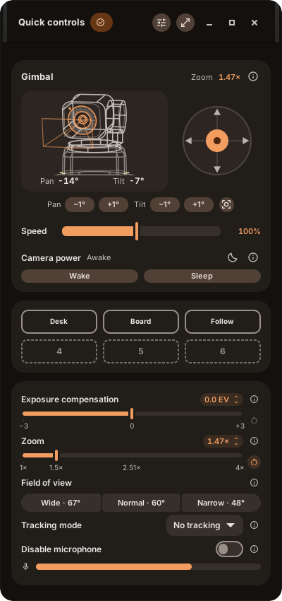

<p align="center"></p>
<h1 align="center">Tiny 2 Lite Control</h1>
<p align="center">A Linux control app for the OBSBOT Tiny 2 Lite webcam: pan and tilt, picture, AI tracking,
gestures, microphone and presets, in one window or a small quick-controls panel.</p>
<p align="center">
  
  
  
  
  
  
</p>
<p align="center">
  <a href="#installation">Install</a> · <a href="#features">Features</a> · <a href="#window-rules">Window rules</a> ·
  <a href="#command-line">Command line</a> · <a href="app/CHANGELOG.md">Changelog</a>
</p>

<p align="center">
  
</p>

---

> **AI disclosure:** This project was written almost entirely by an AI assistant, with direction and
> testing by the author. It has been tested on Linux with Hyprland and a Tiny 2 Lite, but not yet on every
> desktop or firmware version, so review the code before relying on it.

<p align="center">
  
  
  
</p>

## Features

**Gimbal**
- A joystick that turns faster the further you push, 1° fine steps, and a live 3D model of the camera that
  follows its pan, tilt and zoom.
- Gimbal limits, a start-up position, and the camera's three memory positions with names.

**Picture**
- Exposure (auto, shutter, gain, compensation, face metering), white balance, focus (auto, face, manual),
  HDR, brightness, contrast, saturation, sharpness, zoom and field of view.
- A capture mode that stays as you chose it: apps that switch the camera to their own size get theirs while
  they run, and yours comes back after.
- A live preview with tap to focus or track, a pop-out window and focus peaking.
- A Studio camera: a virtual camera with LUTs and a picture for while the camera sleeps.

**AI**
- Tracking modes (upper body, close-up, group, hand and more), tracking speed and a tracking area the camera
  stays inside, with a position to return to.
- Hand gestures: target selection, zoom gesture and dynamic zoom.

**Everyday**
- Presets that save everything above and apply in one click, plus six preset buttons by the joystick.
- Microphone: disable, volume, noise reduction, auto gain, pickup distance and a level meter.
- Power and sleep: wake and sleep, the camera's own sleep timer, and sleep when idle, at shutdown or at
  suspend through the background service.
- Quick controls: a narrow panel with only the controls you pick.
- Daily backups with export and import, and an update check against the latest release.
- System, light or dark theme with an accent colour of your choice.

The camera commands follow OBSBOT's own SDK, so settings are sent the way the camera expects and read back
from it where the camera reports them. The SDK itself is not included or needed.

## Installation

Download `Tiny4LiteControl-x86_64.AppImage` from the
[latest release](https://github.com/HypestHyper/Tiny-4-Lite-control/releases/latest) and start it:

```sh
chmod +x Tiny4LiteControl-x86_64.AppImage
./Tiny4LiteControl-x86_64.AppImage
```

**Install it** (menu entry, icon and the `tiny4lite-control` command): on the **Settings** tab, under
*App and background service*, press **Install**, or run:

```sh
./Tiny4LiteControl-x86_64.AppImage app install
```

This keeps the AppImage in `~/Applications`, links `~/.local/bin/tiny4lite-control` to it and adds the
desktop entry (with *Quick controls* and *Preview* actions) to `~/.local/share/applications`. To update,
put the new AppImage in `~/Applications` and open it. `tiny4lite-control app remove` takes it all away.
Nothing needs root.

**Start the background service** (the capture mode, restore on plug-in, and the sleep timer need it): on
the same card press **Install…**, or from a terminal:

```sh
tiny4lite-control service install systemd --write
systemctl --user daemon-reload && systemctl --user enable --now tiny4lite-control.service
```

Without systemd, `tiny4lite-control service install xdg --write` adds an autostart entry, and
`tiny4lite-control service targets` lists the lines for Hyprland, niri, sway, i3, river, labwc, OpenRC,
runit, s6, dinit and others. `tiny4lite-control service status` says whether it runs.

**Optional:** the Studio camera needs FFmpeg and v4l2loopback (`tiny4lite-control studio setup`), and the
microphone meter needs `parec` (PipeWire or PulseAudio) or `arecord`. `tiny4lite-control requirements`
checks what is there. To build from source, see [app/README.md](app/README.md#building).

## Window rules

Each window has its own class (the `app_id` on Wayland, `WM_CLASS` on X11) and title:

| Window | Class | Title |
| --- | --- | --- |
| Main | `io.github.hypesthyper.Tiny4LiteControl` | `Tiny 2 Lite Control` |
| Quick controls | `io.github.hypesthyper.Tiny4LiteControl.Slim` | `Tiny 2 Lite Control - Quick controls` |
| Preview | `io.github.hypesthyper.Tiny4LiteControl.Preview` | `Tiny 2 Lite Control - Preview` |

Open them with `tiny4lite-control`, `--slim` and `--preview`. For example, a floating quick-controls panel
and a pinned preview:

```ini
# Hyprland before 0.55 (hyprland.conf); 0.55 and later match the same class in hyprland.lua
windowrulev2 = float, class:^(io\.github\.hypesthyper\.Tiny4LiteControl\.Slim)$
windowrulev2 = float, class:^(io\.github\.hypesthyper\.Tiny4LiteControl\.Preview)$
windowrulev2 = pin, class:^(io\.github\.hypesthyper\.Tiny4LiteControl\.Preview)$
```

```kdl
// niri
window-rule {
    match app-id=r#"^io\.github\.hypesthyper\.Tiny4LiteControl\.(Slim|Preview)$"#
    open-floating true
}
```

```sh
# sway
for_window [app_id="io.github.hypesthyper.Tiny4LiteControl.Preview"] floating enable, sticky enable
```

The window's own buttons can be hidden under *Settings → Appearance* if your compositor draws its own.

## Command line

Every setting in the window can be read and changed from a terminal:

```sh
tiny4lite-control list                        # every setting with its value
tiny4lite-control set tracking-mode upper-body
tiny4lite-control toggle autofocus
tiny4lite-control preset apply Desk
tiny4lite-control gimbal step --pan 1          # whole degrees
tiny4lite-control capture set 3840x2160 MJPG 30
```

`tiny4lite-control help` lists the rest; [app/README.md](app/README.md#command-line) has the details.

## Files

| Path | What's in it |
| --- | --- |
| `~/.config/tiny4lite-control/` | Settings, presets, LUTs and daily backups |
| `~/Applications/` | The installed AppImage |
| `~/.local/bin/tiny4lite-control` | The command, a link to the AppImage |

## Credits and license

MIT, see [LICENSE](LICENSE). Not affiliated with OBSBOT. The protocol work builds on
[Domatix/obsbot-control](https://github.com/Domatix/obsbot-control),
[lxman/obsbot-mcp](https://github.com/lxman/obsbot-mcp) and
[OpenFoxes/Tiny4Linux](https://github.com/OpenFoxes/Tiny4Linux); fonts, icons and other sources are listed
in [app/README.md](app/README.md#credits-and-sources). The research notes behind the app are in
[Assistant/](Assistant/INDEX.md).
