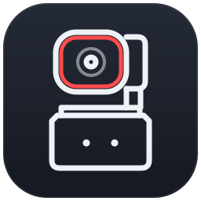
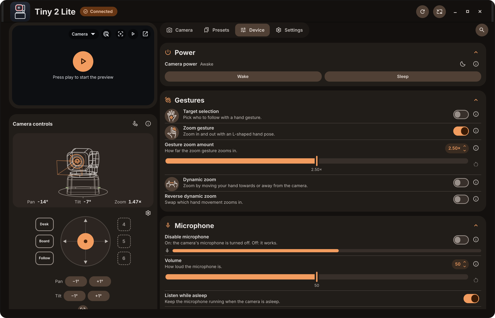
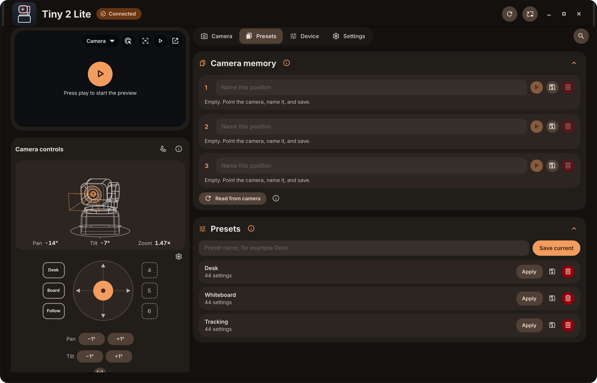

<p align="center"></p>
<h1 align="center">Tiny 2 Lite Control</h1>
<p align="center">A control app for the OBSBOT Tiny 2 Lite webcam on Linux.</p>
<p align="center">
  
  
  
  
  
  
</p>
<p align="center">
  <a href="#installation">Install</a> · <a href="#features">Features</a> · <a href="#windows">Windows</a> ·
  <a href="#command-line">Command line</a> · <a href="app/CHANGELOG.md">Changelog</a>
</p>

---

> **AI disclosure:** This project was written almost entirely by an AI assistant, with direction and
> testing by the author. It has been tested on Linux with Hyprland and a Tiny 2 Lite, but not yet on every
> desktop or firmware version, so review the code before relying on it.

<p align="center">
  
</p>

<p>
  <a href="docs/screenshots/quick-controls.png"></a>
  <a href="docs/screenshots/device.png"></a><br>
  <a href="docs/screenshots/presets.png"></a>
</p>

## Features

- **Gimbal:** pan and tilt with a joystick or 1° steps, zoom, field of view, limits and a start-up
  position.
- **Picture:** exposure, white balance, focus, HDR, brightness, contrast, saturation, sharpness and the
  capture mode.
- **AI tracking:** tracking modes, tracking speed, a tracking area with a return position, and hand
  gestures.
- **Presets:** save the current settings and apply them later. The camera's three memory positions are
  also available.
- **Microphone:** disable, volume, noise reduction, auto gain and pickup distance.
- **Power:** wake and sleep, the camera's sleep timer, and sleep when idle, at shutdown or at suspend.
- **Preview:** a live preview, also in its own window, with tap to focus or track.
- **Studio camera:** an optional virtual camera with LUTs.
- **Quick controls:** a small window with the controls you choose.
- Backups, an update check, a command line, and light and dark themes.

The camera commands are based on OBSBOT's SDK. The SDK is not included and is not needed.

## Installation

Download `Tiny4LiteControl-x86_64.AppImage` from the
[latest release](https://github.com/HypestHyper/Tiny-4-Lite-control/releases/latest) and start it:

```sh
chmod +x Tiny4LiteControl-x86_64.AppImage
./Tiny4LiteControl-x86_64.AppImage
```

**Install it** (menu entry, icon and the `tiny4lite-control` command): on the **Settings** tab, under
*App and background service*, press **Install**, or run:

```sh
./Tiny4LiteControl-x86_64.AppImage app install
```

This keeps the AppImage in `~/Applications`, links `~/.local/bin/tiny4lite-control` to it and adds the
desktop entry (with *Quick controls* and *Preview* actions) to `~/.local/share/applications`. To update,
put the new AppImage in `~/Applications` and open it. `tiny4lite-control app remove` takes it all away.
Nothing needs root.

**Start the background service.** It runs without a window and handles what has to happen while the app
is closed:
- **Capture mode:** apps choose their own resolution when they open the camera, and the camera keeps it
  afterwards. The service puts the mode you chose back once no app is using the camera.
- **Restore on plug-in** (off by default): applies your last settings, or a preset, when the camera is
  plugged in or the computer starts.
- **Sleep:** the sleep timer, and putting the camera to sleep at shutdown or suspend.
- **Studio camera**, if you use it.

Install it from the same card with **Install…**, or from a terminal:

```sh
tiny4lite-control service install systemd --write
systemctl --user daemon-reload && systemctl --user enable --now tiny4lite-control.service
```

Without systemd, `tiny4lite-control service install xdg --write` adds an autostart entry, and
`tiny4lite-control service targets` lists the lines for Hyprland, niri, sway, i3, river, labwc, OpenRC,
runit, s6, dinit and others. `tiny4lite-control service status` says whether it runs.

**Optional:** the Studio camera needs FFmpeg and v4l2loopback (`tiny4lite-control studio setup`), and the
microphone meter needs `parec` (PipeWire or PulseAudio) or `arecord`. `tiny4lite-control requirements`
checks what is there. To build from source, see [app/README.md](app/README.md#building).

## Windows

Each window has its own class (the `app_id` on Wayland, `WM_CLASS` on X11) and title, for window rules in
your compositor:

| Window | Class | Title |
| --- | --- | --- |
| Main | `io.github.hypesthyper.Tiny4LiteControl` | `Tiny 2 Lite Control` |
| Quick controls | `io.github.hypesthyper.Tiny4LiteControl.Slim` | `Tiny 2 Lite Control - Quick controls` |
| Preview | `io.github.hypesthyper.Tiny4LiteControl.Preview` | `Tiny 2 Lite Control - Preview` |

To open each one from a terminal or a keybinding:

```sh
tiny4lite-control             # main window
tiny4lite-control --slim      # quick controls
tiny4lite-control --preview   # preview
```

The window's own buttons can be hidden under *Settings → Appearance* if your compositor draws its own.

## Command line

Every setting in the window can be read and changed from a terminal:

```sh
tiny4lite-control list                        # every setting with its value
tiny4lite-control set tracking-mode upper-body
tiny4lite-control toggle autofocus
tiny4lite-control preset apply Desk
tiny4lite-control gimbal step --pan 1          # whole degrees
tiny4lite-control capture set 3840x2160 MJPG 30
```

`tiny4lite-control help` lists the rest; [app/README.md](app/README.md#command-line) has the details.

## Files

| Path | What's in it |
| --- | --- |
| `~/.config/tiny4lite-control/` | Settings, presets, LUTs and daily backups |
| `~/Applications/` | The installed AppImage |
| `~/.local/bin/tiny4lite-control` | The command, a link to the AppImage |

## Credits and license

MIT, see [LICENSE](LICENSE). Not affiliated with OBSBOT. Fonts, icons and other sources are listed
in [app/README.md](app/README.md#credits-and-sources).

The protocol research looked at [Domatix/obsbot-control](https://github.com/Domatix/obsbot-control),
[lxman/obsbot-mcp](https://github.com/lxman/obsbot-mcp) and
[OpenFoxes/Tiny4Linux](https://github.com/OpenFoxes/Tiny4Linux). No code from them is used: the commands
the app sends come from our own captures of the camera and of OBSBOT's SDK.
